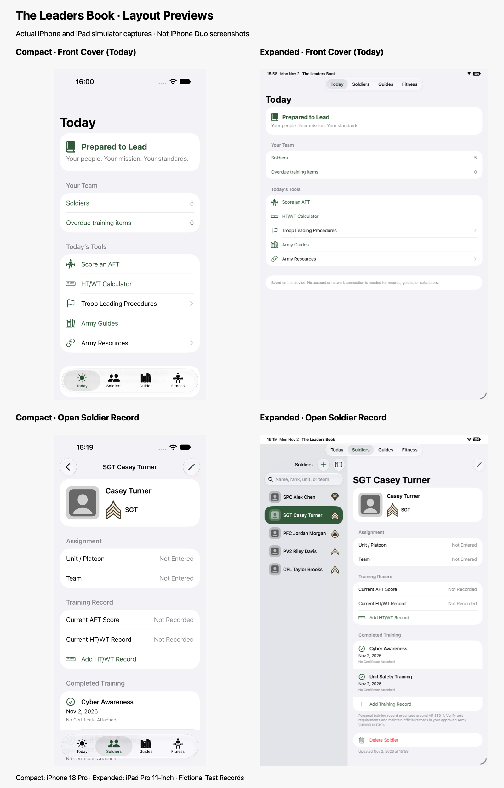

# Compact and Expanded Layout Previews

These are real simulator screenshots from the native app. **Compact** uses iPhone 18 Pro / iOS 27. **Expanded** uses iPad Pro 11-inch / iOS 27. They demonstrate adaptive layouts; they are not closed/open iPhone Duo captures. No Duo simulator device type is installed on this machine.

| View | Compact | Expanded |
| --- | --- | --- |
| Front Cover (Today) | [Full Screenshot](Compact-Cover.png) | [Full Screenshot](Expanded-Cover.png) |
| Open Soldier Record | [Full Screenshot](Compact-Record.png) | [Full Screenshot](Expanded-Record.png) |
| Completed Training Rows | [Full Screenshot](Compact-Training.png) | [Full Screenshot](Expanded-Training.png) |

The corrected captures use only generic drawn person placeholders and clean fictional names: PFC Jordan Morgan, SPC Alex Chen, CPL Taylor Brooks, SGT Casey Turner, and PV2 Riley Davis. No name suffixes or stock portraits are used. These records were created in separate clean preview simulators without modifying existing records or user-selected photos.

Army insignia sources and file formats are documented in [Rank Insignia Credits](../RANK-INSIGNIA.md).

Actual Duo testing remains necessary for the outer display, inner display, partially folded poses, reserved regions, and display-transition continuity described in [Apple’s Dynamic Layouts guidance](https://developer.apple.com/design/human-interface-guidelines/designing-for-iphone-duo#Dynamic-layouts).

## New Theme — Compact and Expanded Previews

The four new-theme screenshots are captured from the actual SwiftUI app. Compact front-cover views represent the closed-layout preview; expanded soldier profiles represent the open-layout preview. They are not Duo hardware or Duo simulator captures.

| View | Light | Dark |
| --- | --- | --- |
| Compact Front Cover — iPhone 18 Pro | [Light](Theme-Compact-Cover-Light.png) | [Dark](Theme-Compact-Cover-Dark.png) |
| Expanded Soldier Profile — iPad Pro 11-inch | [Light](Theme-Expanded-Profile-Light.png) | [Dark](Theme-Expanded-Profile-Dark.png) |

Earlier screenshots above retain the previous system-color appearance. The new-theme captures use isolated fictional records; existing user records and imported photos were preserved.

Light and dark captures use explicit SwiftUI appearance overrides in the Debug preview build because system appearance switching did not update the headless simulator render. These overrides are excluded from Release. Automatic appearance transitions require hardware verification.
