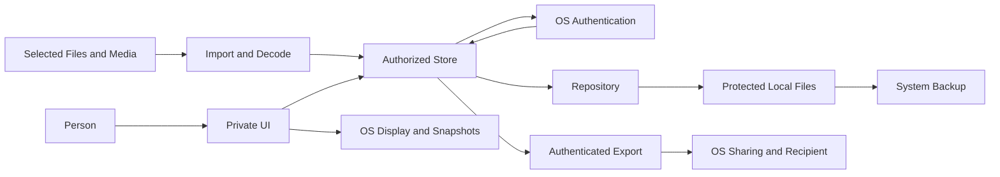

# Notes and Export Threat Model — November 6, 2026
## Executive summary
The confirmed deployment is personal devices with synthetic data pending organizational approval. Current confidentiality consequences are therefore low if that policy is followed. The significant boundaries are fresh-authenticated export, private content surviving async/scene transitions, imported document decoding, and copies outside app storage. No new authentication bypass is demonstrated here. Real-data use needs a new organizational decision and risk assessment; synthetic-only use is policy, not an enforced application mode.
## Scope and assumptions
- User-confirmed: personal devices; synthetic data only until organizational approval. This completes the earlier assumption check-in. Device management, enterprise identity and organizational permission are not established.
- Scope: notes/certificate viewing and export, authentication/session lifetime, attached-file imports, process-memory drafts, local persistence and OS transfers. Evidence is current source at `b991ded`; source inspection is fresh, runtime results are the saved November 6 gate, not newly executed tests.
- Carried-forward user decisions: backup eligibility with disclosure; fresh authentication for exports; one calendar year since last saved Soldier update, warning and confirmed deletion; immediate locking with retained Soldier edits.
- Out of scope: OS compromise, biometric security internals, organization approval, external recipients/backups, distribution signing, public guide links and a general whole-app penetration test. Tests use synthetic fixtures and substitute the external authenticator only in Testing.
- Open before real-data use: authoritative data classification/approval, permitted device and backup arrangements, allowed export recipients, identity requirements and deletion obligations. These could materially increase all confidentiality rankings below.
## System model
### Primary components
`LeaderStore` owns UI/session authorization and protected edits; `DeviceAuthenticator` bridges LocalAuthentication; actor `BookRepository` reads/writes validated records and attachments. `PrivacyControls` implements restricted notes, PDF/image preview and system sharing; `PrivacyShield` handles inactive windows. These are production paths; `script/build_and_run.sh --validate` separately exercises tests and Release compilation.
### Data flows and trust boundaries
- Person → local UI → store: draft text and selected attachment metadata over SwiftUI/UIKit bindings; domain construction validates saved input, and the store requires authorized access (`SoldierEditor.swift`, `LeaderStore.swift`). No app-server authentication or transport is involved.
- Store → OS authentication → store: device-owner authentication result over LocalAuthentication; a new LAContext per request and request/epoch/lease checks gate access (`App/DeviceAuthenticator.swift`, `Core/LeaderStore.swift:48,161`). No PIN or biometric template is stored by the app.
- Files/Photos/Camera → import → repository/preview: user-selected bytes via platform callbacks/security-scoped Files access. `ImportedRecordFile` checks nonempty, ≤10 MB and format signatures; PDFKit/UIImage decode later. Header validation is not complete semantic validation (`Core/RecordAttachment.swift:25`, `Views/RecordFileImport.swift`, `Views/PrivacyControls.swift:125`).
- Repository ↔ sandbox files: Codable DTO/domain parsing and journal/atomic consistency; writes use Complete Data Protection on iOS. Cold locked presentation does not open the private repository; future access is lease-gated (`Core/BookRepository.swift:98,183`, `Core/LeaderStore.swift:48,89`). This is not a separate application-encrypted vault.
- Store → export UI → OS provider → recipient: trusted notes/file bytes over UIActivityViewController/NSItemProvider. Fresh authentication and the original lease precede transfer; the recipient controls accepted copies (`Core/LeaderStore.swift:174`, `Views/PrivacyControls.swift:19,36`).
- UI/memory/files → OS display/snapshot/backup: inactive cover and immediate background locking restrict app presentation; drafts remain in access-controlled process memory. OS screenshots, recording, mirroring and backup retention are not revoked by app lock/deletion (`Views/ContentView.swift`, `Views/PrivacyShield.swift`, `Views/PrivacyControls.swift:5`).
#### Diagram

## Assets and security objectives
| Asset | Why it matters | Security objective |
| --- | --- | --- |
| Synthetic notes, certificates and results | Exercise private-data controls without using real Soldier information | C/I/A; real-data sensitivity requires reassessment |
| Unsaved edits and authorization state | Avoid loss, stale mutation and post-lock disclosure | C/I/A |
| Application availability and saved-record integrity | Imported bytes and scene changes must not corrupt or disable use | I/A |
| External copies and distribution artifacts | App deletion cannot recall copies; test-auth builds must stay out of distribution | C/I |
## Attacker model
### Capabilities
A person may access an unattended unlocked device, know its passcode, supply a selected malformed attachment, or receive an authorized export. An operator can mistakenly enter real data or use an inappropriate backup/recipient. Access requires local interaction or user-mediated import; this scope establishes no anonymous remote endpoint.
### Non-capabilities
Do not assume sandbox escape, root/debugger access or biometric compromise. Device-owner authentication does not identify a particular leader or enforce organizational roles. A person authorized by the device can photograph/transcribe visible data; app copy restrictions do not defeat that capability.
## Entry points and attack surfaces
| Surface | How reached | Trust boundary | Notes | Evidence |
| --- | --- | --- | --- | --- |
| Notes/save/restore | Soldier editor | UI → domain/session | Incomplete drafts are not committed records | `Views/SoldierEditor.swift`, `Core/SoldierEditSession.swift` |
| Unlock/export | Buttons and async callbacks | App ↔ OS identity; app → recipient | Fresh export challenge; stale results rejected | `Core/LeaderStore.swift:161`, `App/DeviceAuthenticator.swift` |
| Certificate/photo bytes | Files/Photos/Camera import | Provider → decoder/storage | Bounded envelope; platform parsing remains exposed | `Core/RecordAttachment.swift:25`, `Views/PrivacyControls.swift:125` |
| Background/disconnect | UIKit notifications/scenes | Visible state → protected memory/OS snapshot | Cover/dismissal plus lease revocation; device checks open | `Views/PrivacyShield.swift`, `Core/LeaderStore.swift:73,189` |
| Backup/deletion | OS backup and confirmed deletion | Sandbox → external retained copies | Eligible backups and exports are outside app deletion | `Core/BookRepository.swift`, `Views/PrivacyControls.swift:5` |
## Top abuse paths
1. TM-001: obtain stale access → start a read/export → lock before completion → attempt to publish bytes under old authorization; request/epoch/lease checks are the defense.
2. TM-002: bypass deliberate export → invoke copy, drag, Writing Tools or preview sharing → move data to another app; restricted notes/read-only preview remove intended implicit routes.
3. TM-003: disrupt use → persuade the operator to import a small but complex PDF/image → trigger expensive parsing/text extraction → degrade UI availability despite the byte cap.
4. TM-004: observe content → access an unlocked display or record/mirror it → retain visible information beyond lock; inactive covers only address part of this path.
5. TM-005: retain an external copy → receive an export or access a backup → keep it after app deletion/retention warning → defeat an assumption of complete erasure.
6. TM-006: misuse deployment → enter actual Soldier data on a personal device before approval → back up/export it under synthetic-test assumptions → cross an unapproved organizational boundary.
## Threat model table
| Threat ID | Threat source | Prerequisites | Threat action | Impact | Impacted assets | Existing controls (evidence) | Gaps | Recommended mitigations | Detection ideas | Likelihood | Impact severity | Priority |
| --- | --- | --- | --- | --- | --- | --- | --- | --- | --- | --- | --- | --- |
| TM-001 | Local actor/stale callback | Operation spans lock or scene change | Reuse prior authorization | Synthetic disclosure or stale edits | Notes, certificates, drafts | Request/epoch/lease checks; `LeaderStore.swift:48,118,161`; RecordAccess/SoldierEdit tests | Physical prompts/provider timing unverified | Preserve race tests; exercise real lock/cancel flows | Synthetic callback/lease assertions, without logging content | Low: checks and saved tests cover intended paths | Low under confirmed data policy; high if real data | low |
| TM-002 | Local operator or implicit UI route | Private content is open | Copy/share without a fresh challenge | Unintended inter-app transfer | Notes/certificates | Restricted editor and explicit export; `PrivacyControls.swift:19,56,90`; public guide selection is separate | OS/keyboard/VoiceOver routes not exhaustively tested | Test hardware keyboard, selection menus, drag, accessibility and certificate destinations | UI tests asserting denied transfer and fresh challenges | Low: intended routes restricted; platform gaps remain | Low for synthetic content; high conditionally | low |
| TM-003 | Attachment supplier | User selects a complex file ≤10 MB | Exhaust decode/text-extraction work | UI hang or process termination | Availability, unsaved work | Envelope checks and decoder failures; `RecordAttachment.swift:29`; owned tasks | No page/pixel/work budget; synchronous extraction may block cancellation | Profile adversarial synthetic PDFs/images; set measured limits at decode boundary if needed | Hangs/allocations traces and bounded completion tests | Medium: selected complex inputs remain plausible | Medium: local disruption/re-entry cost | medium |
| TM-004 | Observer or person with device access | Unlocked content or passcode access | View/record/export visible data | Copy outside app control | Displayed content/drafts | Immediate lock and window shield; `ContentView.swift`, `PrivacyShield.swift` | Screenshots/mirroring not prevented; shared passcode is not per-leader identity | Keep synthetic-only use; verify device snapshots; revisit identity/device policy before real data | Synthetic app-switcher and locked accessibility-tree checks | Medium: personal devices can be observed/shared | Low for synthetic content; high conditionally | low |
| TM-005 | Recipient or backup accessor | Authorized export or accessible backup | Retain copies after deletion | Persistence outside app retention | External data copies | Disclosure and confirmed deletion; `DataPolicyView`; transactional cleanup | No recall or backup erasure; backup account/access policy unknown | Review account/recipient/backup policy before real data; never promise global deletion | Test app deletion boundary; audit disclosed policy without content telemetry | Medium: copies deliberately permitted | Low for synthetic data; high conditionally | low |
| TM-006 | Operator mistake | Real data entered before approval | Use synthetic-test deployment for sensitive records | Organizational/privacy exposure | Actual Soldier information | User-confirmed synthetic-only policy; no app enforcement | App cannot determine whether names/files are real; approval absent | Keep fixtures synthetic; obtain authoritative approval/classification before changing usage; do not purge existing data automatically | Human fixture/release review; no sensitive data logging | Low under confirmed policy; increases if policy is ignored | High if prerequisite occurs; not a demonstrated incident | medium |
## Criticality calibration
Current synthetic-only scope supports no established critical/high vulnerability. Critical examples requiring changed context: systemic unauthenticated real-data export; unrecoverable destruction of an approved authoritative dataset. High examples after real-data adoption: fresh-auth bypass exposing a certificate; private content in device snapshots. Medium examples here: repeatable complex-file denial of service; operating with real data despite the confirmed approval gate. Low examples here: synthetic clipboard leakage; retained synthetic backup copies. These are calibration examples, not reproduced findings or App Store severity rules.
## Focus paths for security review
| Path | Why it matters | Related Threat IDs |
| --- | --- | --- |
| `LeadersBook/Core/LeaderStore.swift` / `RecordAccess.swift` | Authorize before/after suspension; revoke old sessions | TM-001, TM-002 |
| `LeadersBook/Views/PrivacyControls.swift` | Restricted editing, decode cost, provider handoff and accessibility trade-off | TM-002, TM-003, TM-005 |
| `LeadersBook/Views/PrivacyShield.swift` / `ContentView.swift` | Presented surfaces and lifecycle transitions | TM-001, TM-004 |
| `LeadersBook/Core/BookRepository.swift` / `RecordAttachment.swift` | Validation, protected writes and retained-copy/deletion limits | TM-003, TM-005 |
| `docs/ARCHITECTURE-AUDIT.md` / `script/build_and_run.sh` | Deployment approval and separation of Testing/Release evidence | TM-006 |
## Notes on use
Quality check: all scoped entry surfaces and trust edges above map to TM-001–006; runtime, OS/recipient and build/test responsibilities are distinct; the user's deployment answer is incorporated; remaining organizational/hardware assumptions stay explicit. Saved gate evidence is 50 core/20 native tests plus unsigned Release compilation (`docs/validation/release-review-2026-11-06/`); those tests do not certify real biometrics, device protection, accessibility or deployment approval. Reassess this model before accepting real Soldier data. Public-guide copy is intentional. Formalizing this model changes documentation only: it does not add a synthetic-only switch, change backups, recall exports or delete records.
